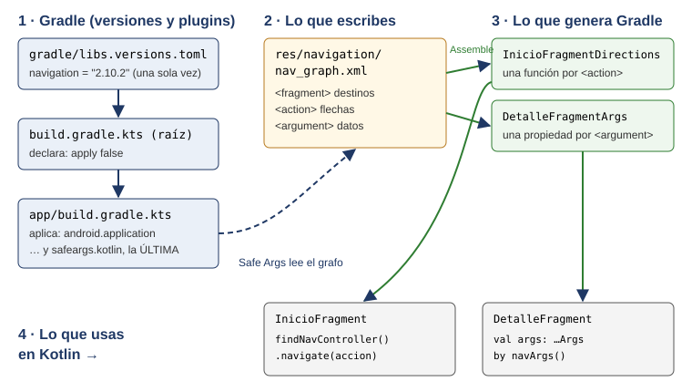

# Plantilla · Fragmentos + Navigation + Safe Args

Proyecto de Android Studio listo para empezar una app con **fragmentos**, el
**componente Navigation** (`NavHostFragment` + grafo) y **Safe Args**. Trae todo
Gradle configurado y un ejemplo mínimo que funciona: dos fragmentos, una acción
con animación y un argumento de texto.



## Qué trae

```
PlantillaNavegacion/
├── settings.gradle.kts         ← nombre del proyecto
├── build.gradle.kts            ← raíz: plugins DECLARADOS (apply false)
├── gradle/libs.versions.toml   ← TODAS las versiones
└── app/
    ├── build.gradle.kts        ← plugins APLICADOS, viewBinding, dependencias
    └── src/main/
        ├── java/es/sanclemente/plantilla/
        │   ├── MainActivity.kt      ← barra + NavHostFragment
        │   ├── InicioFragment.kt    ← navega con Directions
        │   └── DetalleFragment.kt   ← recibe con navArgs()
        └── res/
            ├── navigation/nav_graph.xml
            ├── layout/  activity_main, fragment_inicio, fragment_detalle
            ├── anim/    entrar/sair dereita/esquerda
            └── values/, values-es/, values-night/
```

## Versiones

| Pieza | Versión | Dónde se cambia |
|---|---|---|
| Android Gradle Plugin | 9.4.1 | `libs.versions.toml` → `agp` |
| Gradle | 9.6.0 | `gradle/wrapper/gradle-wrapper.properties` |
| Navigation **y** Safe Args | 2.10.2 | `libs.versions.toml` → `navigation` (una sola línea para las dos) |
| compileSdk / targetSdk / minSdk | 37 / 36 / 24 | `app/build.gradle.kts` |

Compatibilidad AGP → Navigation/Safe Args: **8.x → 2.8.x · 9.0 → 2.9.5 · 9.4 → 2.10.2**.
Si tu Android Studio crea proyectos con otro AGP, cambia la línea `agp` y ajusta
`navigation` según esa tabla.

## Abrirla

1. Descomprime el zip en una carpeta tuya.
2. **File → Open** → la carpeta `PlantillaNavegacion` (la que contiene `settings.gradle.kts`).
3. Deja que haga el *Sync*. La primera vez descarga Gradle y las dependencias.
4. Si pide instalar **Android API 37**, acepta.
5. **Build → Assemble Project**. Con eso se generan las clases de Safe Args.

## Empezar un proyecto nuevo a partir de ella

**Lo mínimo (sin riesgo):** cambia estas tres cosas y ya tienes una app distinta
que se instala al lado de las demás.

| Qué | Dónde |
|---|---|
| Nombre del proyecto | `settings.gradle.kts` → `rootProject.name` |
| Identificador de la app | `app/build.gradle.kts` → `applicationId` |
| Nombre en el móvil | `res/values/strings.xml` y `values-es/strings.xml` → `app_name` |

**Cambiar también el paquete** (`es.sanclemente.plantilla`) es opcional. Si lo
haces, tienen que coincidir **cuatro sitios**:

1. `namespace` en `app/build.gradle.kts`.
2. Las carpetas `java/es/sanclemente/plantilla/`.
3. La línea `package` de cada `.kt` y los `import ….databinding.…`.
4. Los `android:name` de `nav_graph.xml`.

Android Studio lo hace casi todo con **clic derecho sobre el paquete → Refactor → Rename**;
después revisa el punto 4 a mano y haz **Build → Clean Project** + **Build → Assemble Project**.

## Añadir una pantalla nueva

1. Crea el layout `fragment_loquesea.xml` y la clase `LoqueseaFragment.kt`
   (copia `DetalleFragment.kt` y cambia el nombre del binding).
2. En `nav_graph.xml`: añade el `<fragment>` con su `android:id`, `android:name` y `android:label`.
3. Añade la `<action>` **dentro** del fragmento de origen, con `app:destination`.
4. Si recibe datos, añade los `<argument>` **dentro** del fragmento de destino.
5. **Build → Assemble Project**. Ahora existen `…Directions.accion…()` y `…Args`.
6. Navega con `findNavController().navigate(…Directions.accion…(datos))`
   y recibe con `private val args: …Args by navArgs()`.

Tipos de argumento más usados: `string`, `integer`, `boolean`, `float`, `long`.
Para dar un valor por omisión: `android:defaultValue="0"`.

## Las reglas de Gradle que no se tocan

- **Raíz**: los plugins con `apply false`. Safe Args toma la versión del catálogo.
- **Módulo**: Safe Args **sin versión**, **sin** `apply false` y **el último** del bloque `plugins`.
- Siempre `androidx.navigation.safeargs.kotlin`, **nunca** `safeargs` a secas (genera Java).
- **No** añadas `org.jetbrains.kotlin.android`: desde AGP 9.0 Kotlin va integrado y aplicarlo da error.

## Si algo falla

| Síntoma | Causa y solución |
|---|---|
| `safeargs plugin must be used with android plugin` | Safe Args más antiguo que el AGP. Sube `navigation` según la tabla de compatibilidad. |
| `Unresolved reference: InicioFragmentDirections` (o `…Args`) | Las clases aún no se han generado. **Build → Assemble Project**. Si sigue: **Clean Project** + **Assemble Project**. |
| El *Sync* falla nada más abrir | Versiones del catálogo que tu Android Studio no conoce. Ajusta `agp` y `navigation`. |
| La app se cierra al llegar a un destino | Falta un argumento obligatorio: la acción no lo pasa o el `<argument>` está en otro fragmento. |
| Cambié el grafo y no veo el cambio | **Assemble Project** otra vez. |

En el menú **Build**: *Make* equivale a **Assemble Project**; *Rebuild* equivale
a **Clean Project** + **Assemble Project**. No uses **Compile All Sources**:
se salta el procesamiento de recursos y no genera Safe Args ni ViewBinding.

## Lista de prueba

- [ ] Arranca en «Inicio», con título en la barra y **sin** flecha.
- [ ] Escribir un texto y pulsar «Seguinte» desliza a «Detalle» y muestra el texto.
- [ ] Sin escribir nada, «Detalle» muestra «(sen mensaxe)».
- [ ] La flecha de la barra, el botón «Volver» y el «atrás» del sistema hacen lo mismo.
- [ ] Girar en «Detalle» no pierde el texto.
- [ ] Con el emulador en castellano, los textos salen en castellano.
- [ ] Modo oscuro: la app sigue siendo legible.

